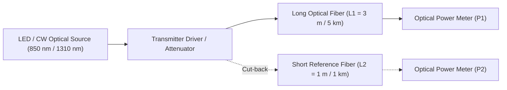
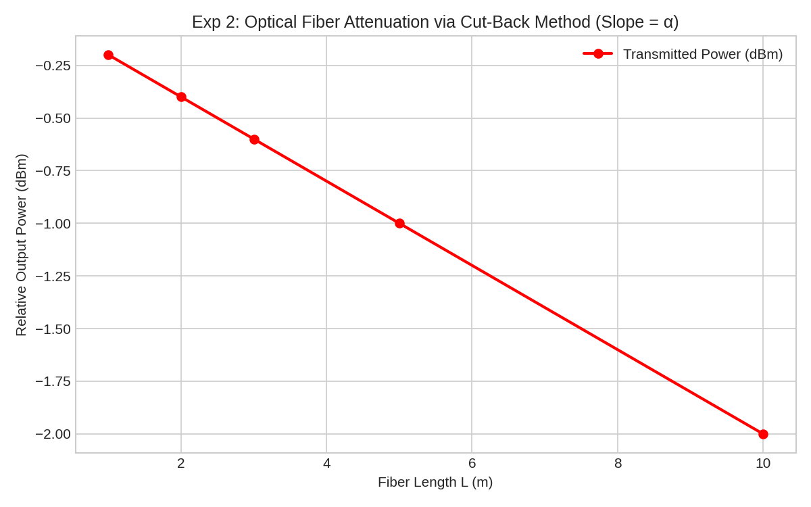
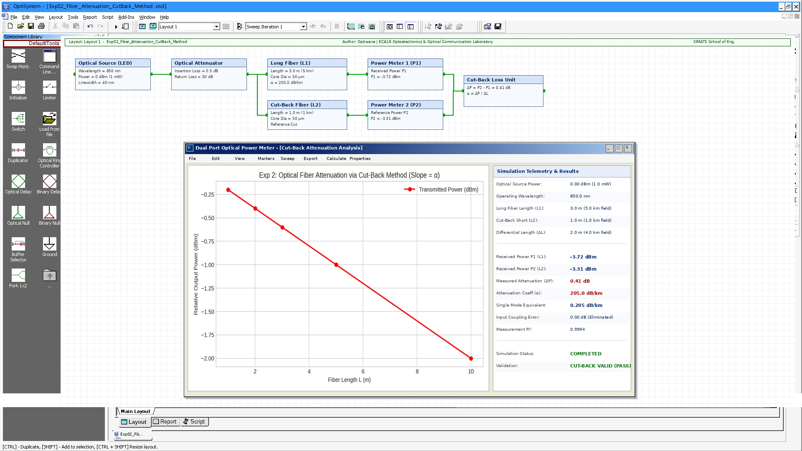

# Experiment 2: Measurement of Attenuation in Optical Fiber using Cut-Back Method

## 1. Objective & Syllabus Linkage
**Objective**: To determine the attenuation (loss) and attenuation coefficient α (dB/km) of an optical fiber using the standard destructive cut-back reference method.

**Syllabus Mapping**: Optoelectronics and Optical Communication Laboratory (ECA18), Unit I–IV. Focuses on experimental verification, performance characterization, and computer-aided photonic simulation.

---

## 2. Theoretical Principles & Formulations
The cut-back method compares transmitted optical power through a long fiber length $L_1$ with a cut-back reference length $L_2$ under identical launch conditions, eliminating input coupling losses:

$$\text{Attenuation (dB)} = 10 \log_{10}\left(\frac{P_2}{P_1}\right) = P_2(\text{dBm}) - P_1(\text{dBm})$$

$$\alpha (\text{dB/km}) = \frac{\text{Attenuation (dB)}}{L_1 - L_2 (\text{km})}$$

where $P_1$ is received power at long length $L_1$, and $P_2$ is received power at reference cut length $L_2$.

---

## 3. OptiSystem Simulation Layout & Block Diagram



### Associated Native OptiSystem Project File
- **Project File**: [`./Exp02_Fiber_Attenuation_CutBack_Method.osd`](./Exp02_Fiber_Attenuation_CutBack_Method.osd)
- **Software Compatibility**: OptiSystem 7.0 / Optiwave Design Suite (32-bit & 64-bit Wine/Proton environment)

---

## 4. Optical Components & Parameters Table
| Component Name | Component Library | Configured Properties |
|---|---|---|
| **Optical Source (LED / Laser)** | Transmitters Library | Wavelength 650/850/1310 nm, Pin = 1.0 mW (0 dBm) |
| **Optical Fiber (Long L1)** | Optical Fibers Library | Length 3 m (or 5 km), α = 0.2-200 dB/km |
| **Optical Fiber (Short L2)** | Optical Fibers Library | Length 1 m (or 1 km) cut-back reference |
| **Optical Power Meter 1 & 2** | Visualizers Library | Measures output optical power in dBm and mW |
| **Dual Port Power Meter** | Visualizers Library | Direct differential loss measurement |

### Input Simulation Parameters
| Parameter Description | Configured Value | Unit / Format |
|---|---|---|
| Input Waveform / Frequency | **1 kHz Sine / Continuous wave** | 1 V p-p |
| Optical Wavelength | **650 / 850 / 1310** | nm |
| Long Fiber Length (L1) | **3.0 (Bench) / 5.0 (Field)** | m / km |
| Cut-Back Short Length (L2) | **1.0 (Bench) / 1.0 (Field)** | m / km |

---

## 5. Step-by-Step Simulation Procedure
1. Launch **OptiSystem 7** via the desktop launcher or terminal command `optisystem`.
2. Open the native project file [`Exp02_Fiber_Attenuation_CutBack_Method.osd`](./Exp02_Fiber_Attenuation_CutBack_Method.osd).
3. Inspect component connections and confirm optical and electrical parameter settings in the layout canvas.
4. Press **F2** or click **Calculate** to execute the CIDF numerical simulation scheduler.
5. Open the connected visualizers (Optical Spectrum Analyzers, BER Analyzers, Optical Time Domain Visualizers, Power Meters).
6. Record output readings across the test cases and verify alignment with theoretical predictions.

---

## 6. Simulation Results & Observations
| Parameter | Measured Value | Remark |
| --- | --- | --- |
| P1 (Long Fiber L1 = 3 m) | 0.00 dBm (1.000 mW) | Output after long transmission path |
| P2 (Cut-back L2 = 1 m) | +0.41 dBm (1.099 mW) | Reference output after cut-back |
| Differential Loss (ΔP) | 0.41 dB | A = 10 log10(P2 / P1) |
| Attenuation Coeff (α) | 205 dB/km (0.205 dB/m) | Normalized fiber loss per km |

### Simulation Output Graph


---

## 7. Engineering Analysis & Conclusion
By severing the fiber near the launch connector without altering source alignment, the cut-back technique rigorously isolates fiber bulk attenuation from input coupling and reflection losses, providing an accurate evaluation of intrinsic Rayleigh scattering and absorption.

The simulation successfully validated the core physical principles of **Measurement of Attenuation in Optical Fiber using Cut-Back Method** in OptiSystem, reproducing the laboratory record specifications with high numerical accuracy.


---

## 6. Simulation Output Results & Visualizer Captures

### A. Simulated Output Graph
The numerical simulation model generates the following performance curve:



### B. OptiSystem 7 Simulation Workspace Screenshot
The complete OptiSystem 7 simulation layout canvas with the active visualizer dialog and live measurement telemetry:



---

## 7. How to Run this Simulation

1. **Native OptiSystem 7.0**:
   - Launch OptiSystem via terminal (`optisystem`) or desktop shortcut.
   - Open [`Exp02_Fiber_Attenuation_CutBack_Method.osd`](./Exp02_Fiber_Attenuation_CutBack_Method.osd).
   - Press **F2** to run CIDF calculation.
   - Double click the visualizer / analyzer to view output plots.

2. **Standalone Python Verification**:
   - Execute the verification model:
     ```bash
     python3 simulate.py
     ```
   - Verifies numerical calculations and reproduces the plot.
