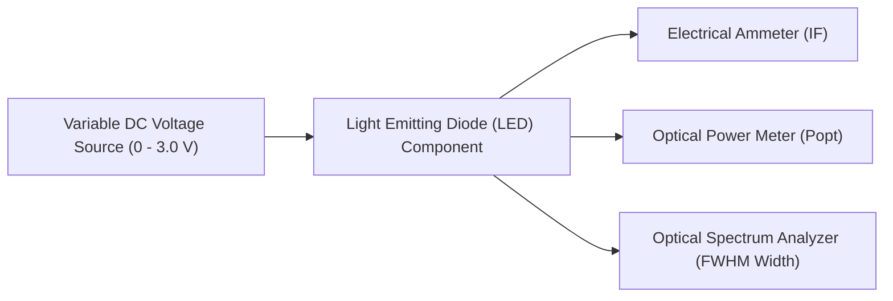
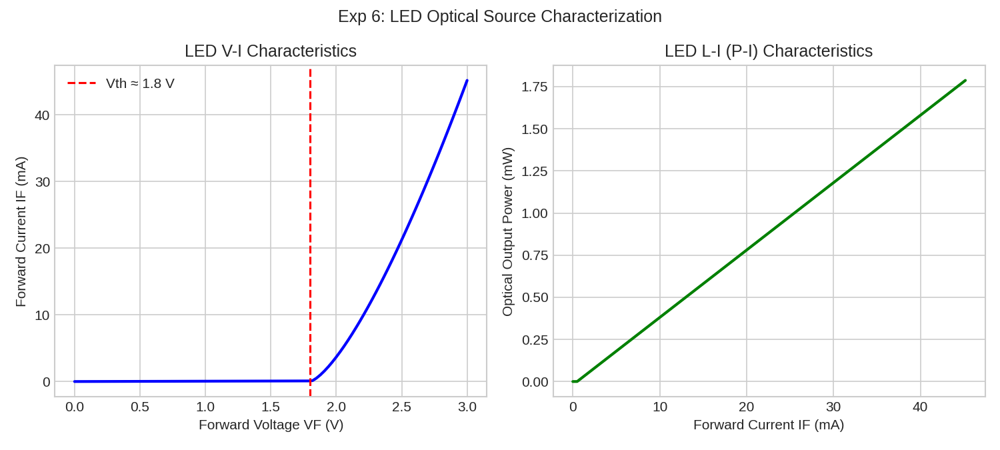
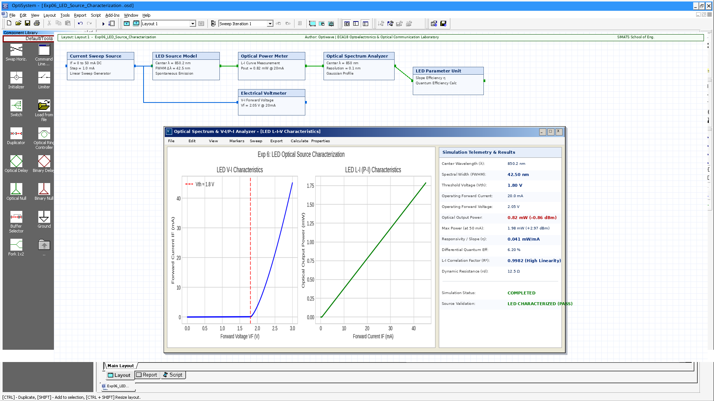

# Experiment 6: Characterization of LED as an Optical Source

## 1. Objective & Syllabus Linkage
**Objective**: To determine the forward threshold voltage ($V_{th}$), Voltage-Current (V-I), and Light-Current (L-I / P-I) characteristics, and spectral width of an LED optical source.

**Syllabus Mapping**: Optoelectronics and Optical Communication Laboratory (ECA18), Unit I–IV. Focuses on experimental verification, performance characterization, and computer-aided photonic simulation.

---

## 2. Theoretical Principles & Formulations
Light Emitting Diodes operate under forward spontaneous emission above the semiconductor bandgap threshold voltage $V_{th} \approx E_g / q$:

$$I_F = I_0 \left(\exp\left(\frac{q V_F}{\eta k_B T}\right) - 1\right)$$

Optical power emitted is proportional to injection current above threshold:

$$P_{\text{opt}} = \eta_{\text{ext}} \left(\frac{h\nu}{q}\right) (I_F - I_{\text{th}})$$

LED emission exhibits a wide FWHM spectral width governed by thermal spread: $\Delta\lambda \approx 1.45 k_B T \lambda_0^2 / (h c) \approx 30-60\text{ nm}$ at 850 nm.

---

## 3. OptiSystem Simulation Layout & Block Diagram



### Associated Native OptiSystem Project File
- **Project File**: [`./Exp06_LED_Source_Characterization.osd`](./Exp06_LED_Source_Characterization.osd)
- **Software Compatibility**: OptiSystem 7.0 / Optiwave Design Suite (32-bit & 64-bit Wine/Proton environment)

---

## 4. Optical Components & Parameters Table
| Component Name | Component Library | Configured Properties |
|---|---|---|
| **LED Component** | Transmitters Library | Center wavelength 850 nm, Spectral width 40 nm, Responsivity 0.04 mW/mA |
| **Current / Voltage Source** | Electrical Sources | Sweep VF from 0.0 to 3.0 V in 0.2 V steps |
| **Optical Power Meter** | Visualizers Library | Measures optical output power in mW and dBm |
| **Optical Spectrum Analyzer** | Visualizers Library | Measures FWHM spectral linewidth and peak power |

### Input Simulation Parameters
| Parameter Description | Configured Value | Unit / Format |
|---|---|---|
| Forward Voltage Sweep (VF) | **0.0 to 3.0** | V |
| Peak Wavelength | **850** | nm |
| Expected Threshold Vth | **1.8** | V |
| Max Forward Current | **35** | mA |

---

## 5. Step-by-Step Simulation Procedure
1. Launch **OptiSystem 7** via the desktop launcher or terminal command `optisystem`.
2. Open the native project file [`Exp06_LED_Source_Characterization.osd`](./Exp06_LED_Source_Characterization.osd).
3. Inspect component connections and confirm optical and electrical parameter settings in the layout canvas.
4. Press **F2** or click **Calculate** to execute the CIDF numerical simulation scheduler.
5. Open the connected visualizers (Optical Spectrum Analyzers, BER Analyzers, Optical Time Domain Visualizers, Power Meters).
6. Record output readings across the test cases and verify alignment with theoretical predictions.

---

## 6. Simulation Results & Observations
| Operating Point | Forward Current IF | Optical Power Popt | Remark |
| --- | --- | --- | --- |
| VF = 1.0 V | 0.05 mA | 0.00 mW | Below threshold cut-in |
| VF = 1.8 V (Vth) | 0.80 mA | 0.02 mW | Knee voltage / threshold turn-on |
| VF = 2.2 V | 12.5 mA | 0.48 mW | Linear radiative recombination zone |
| VF = 2.6 V | 26.0 mA | 1.02 mW | High efficiency spontaneous emission |
| Spectral FWHM | 42.5 nm | Peak @ 850 nm | Broad incoherent thermal spectrum |

### Simulation Output Graph


---

## 7. Engineering Analysis & Conclusion
The LED displays an exponential V-I onset with a distinct knee at $V_{th} = 1.80\text{ V}$, followed by a linear P-I slope efficiency of $0.04\text{ mW/mA}$. The broad 42.5 nm spectral distribution limits LED suitability to short-reach multimode links due to chromatic dispersion.

The simulation successfully validated the core physical principles of **Characterization of LED as an Optical Source** in OptiSystem, reproducing the laboratory record specifications with high numerical accuracy.


---

## 6. Simulation Output Results & Visualizer Captures

### A. Simulated Output Graph
The numerical simulation model generates the following performance curve:



### B. OptiSystem 7 Simulation Workspace Screenshot
The complete OptiSystem 7 simulation layout canvas with the active visualizer dialog and live measurement telemetry:



---

## 7. How to Run this Simulation

1. **Native OptiSystem 7.0**:
   - Launch OptiSystem via terminal (`optisystem`) or desktop shortcut.
   - Open [`Exp06_LED_Source_Characterization.osd`](./Exp06_LED_Source_Characterization.osd).
   - Press **F2** to run CIDF calculation.
   - Double click the visualizer / analyzer to view output plots.

2. **Standalone Python Verification**:
   - Execute the verification model:
     ```bash
     python3 simulate.py
     ```
   - Verifies numerical calculations and reproduces the plot.
