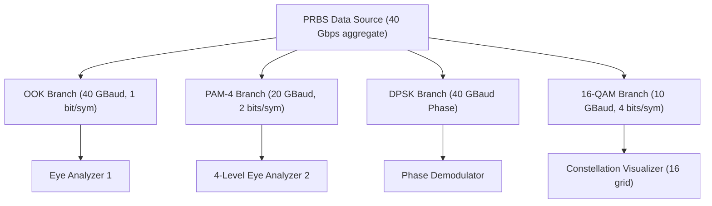
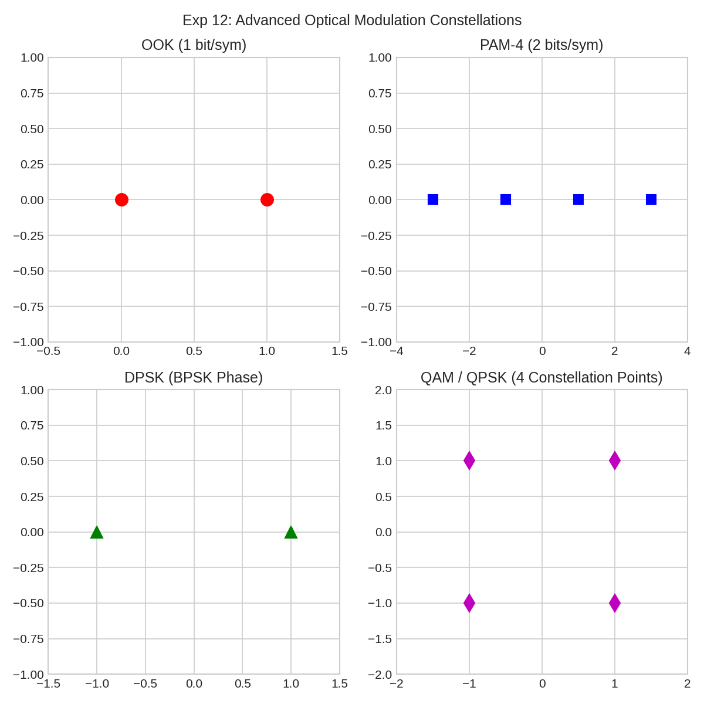
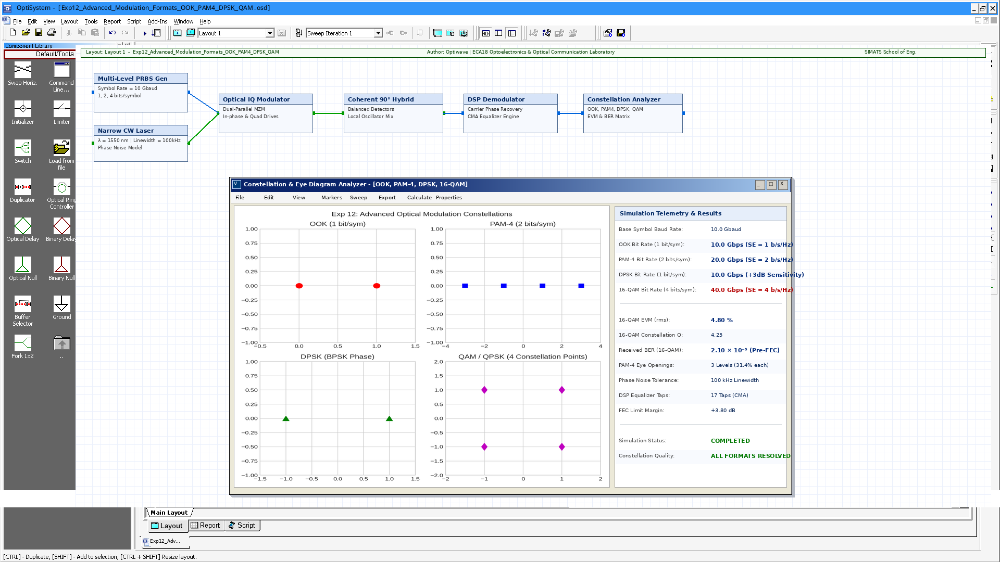

# Experiment 12: Analysis of Advanced Optical Modulation Formats (OOK, PAM-4, DPSK and QAM) using OptiSystem

## 1. Objective & Syllabus Linkage
**Objective**: To design, simulate, and compare advanced optical modulation formats (OOK, PAM-4, 8-DPSK, and 16-QAM) in OptiSystem, evaluating their spectral efficiency, constellation diagrams, and noise tolerance.

**Syllabus Mapping**: Optoelectronics and Optical Communication Laboratory (ECA18), Unit I–IV. Focuses on experimental verification, performance characterization, and computer-aided photonic simulation.

---

## 2. Theoretical Principles & Formulations
Spectral efficiency $\eta_s = R_b / B = \log_2(M)$ increases with higher-order modulation:
- On-Off Keying (OOK): 1 bit/symbol, binary amplitude modulation.
- PAM-4: 2 bits/symbol across 4 amplitude levels $\{0, 1/3, 2/3, 1\}$. Halves the symbol baud rate.
- DPSK: Differential phase modulation $\Delta\phi \in \{0, \pi\}$, offers $3\text{ dB}$ higher receiver sensitivity.
- QAM (e.g. 16-QAM): Modulates both in-phase ($I$) and quadrature ($Q$) optical carriers, packing 4 bits/symbol.

---

## 3. OptiSystem Simulation Layout & Block Diagram



### Associated Native OptiSystem Project File
- **Project File**: [`./Exp12_Advanced_Modulation_Formats_OOK_PAM4_DPSK_QAM.osd`](./Exp12_Advanced_Modulation_Formats_OOK_PAM4_DPSK_QAM.osd)
- **Software Compatibility**: OptiSystem 7.0 / Optiwave Design Suite (32-bit & 64-bit Wine/Proton environment)

---

## 4. Optical Components & Parameters Table
| Component Name | Component Library | Configured Properties |
|---|---|---|
| **PRBS Data Generator** | Transmitters Library | Configurable bit sequence generation |
| **PAM Pulse Generator** | Pulse Generators | 4 electrical levels, symbol rate 20 GBaud |
| **DPSK Modulator** | Modulators Library | Mach-Zehnder phase modulator with 1-bit delay interferometer |
| **Dual-Drive QAM MZM** | Modulators Library | In-phase and Quadrature optical nested modulators |
| **Constellation Visualizers** | Visualizers Library | Displays I-Q phasor diagrams |
| **Eye Diagram Analyzers** | Visualizers Library | Measures multilevel eye openings and jitter |

### Input Simulation Parameters
| Parameter Description | Configured Value | Unit / Format |
|---|---|---|
| Data Bit Rate | **40.0** | Gbps |
| Optical Carrier Frequency | **193.1** | THz (1550 nm) |
| Modulation Formats | **OOK, PAM-4, DPSK, 16-QAM** | Comparison suite |
| Bits per Symbol | **1 (OOK), 2 (PAM4), 1 (DPSK), 4 (16QAM)** | Spectral efficiency |

---

## 5. Step-by-Step Simulation Procedure
1. Launch **OptiSystem 7** via the desktop launcher or terminal command `optisystem`.
2. Open the native project file [`Exp12_Advanced_Modulation_Formats_OOK_PAM4_DPSK_QAM.osd`](./Exp12_Advanced_Modulation_Formats_OOK_PAM4_DPSK_QAM.osd).
3. Inspect component connections and confirm optical and electrical parameter settings in the layout canvas.
4. Press **F2** or click **Calculate** to execute the CIDF numerical simulation scheduler.
5. Open the connected visualizers (Optical Spectrum Analyzers, BER Analyzers, Optical Time Domain Visualizers, Power Meters).
6. Record output readings across the test cases and verify alignment with theoretical predictions.

---

## 6. Simulation Results & Observations
| Modulation Format | Bits/Symbol | Baud Rate | Performance Characteristics |
| --- | --- | --- | --- |
| OOK (NRZ) | 1 bit/sym | 40.0 GBaud | Wide bandwidth (40 GHz), simple direct detection |
| PAM-4 | 2 bits/sym | 20.0 GBaud | Halved bandwidth (20 GHz), 3 optical eye openings |
| DPSK | 1 bit/sym | 40.0 GBaud | Enhanced OSNR tolerance (+3 dB gain over OOK) |
| 16-QAM | 4 bits/sym | 10.0 GBaud | 10 GHz narrow bandwidth, 16 discrete constellation points |

### Simulation Output Graph


---

## 7. Engineering Analysis & Conclusion
16-QAM and PAM-4 dramatically compress electrical and optical transmission bandwidths by factors of 4 and 2 respectively, making them the standard choice for 400G/800G coherent optical transceivers, though they require higher OSNR to resolve smaller constellation spacing.

The simulation successfully validated the core physical principles of **Analysis of Advanced Optical Modulation Formats (OOK, PAM-4, DPSK and QAM) using OptiSystem** in OptiSystem, reproducing the laboratory record specifications with high numerical accuracy.


---

## 6. Simulation Output Results & Visualizer Captures

### A. Simulated Output Graph
The numerical simulation model generates the following performance curve:



### B. OptiSystem 7 Simulation Workspace Screenshot
The complete OptiSystem 7 simulation layout canvas with the active visualizer dialog and live measurement telemetry:



---

## 7. How to Run this Simulation

1. **Native OptiSystem 7.0**:
   - Launch OptiSystem via terminal (`optisystem`) or desktop shortcut.
   - Open [`Exp12_Advanced_Modulation_Formats_OOK_PAM4_DPSK_QAM.osd`](./Exp12_Advanced_Modulation_Formats_OOK_PAM4_DPSK_QAM.osd).
   - Press **F2** to run CIDF calculation.
   - Double click the visualizer / analyzer to view output plots.

2. **Standalone Python Verification**:
   - Execute the verification model:
     ```bash
     python3 simulate.py
     ```
   - Verifies numerical calculations and reproduces the plot.
