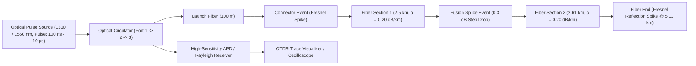
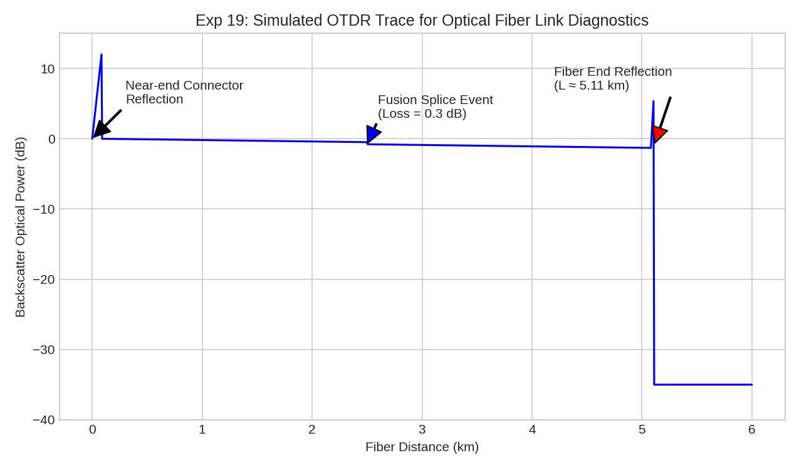
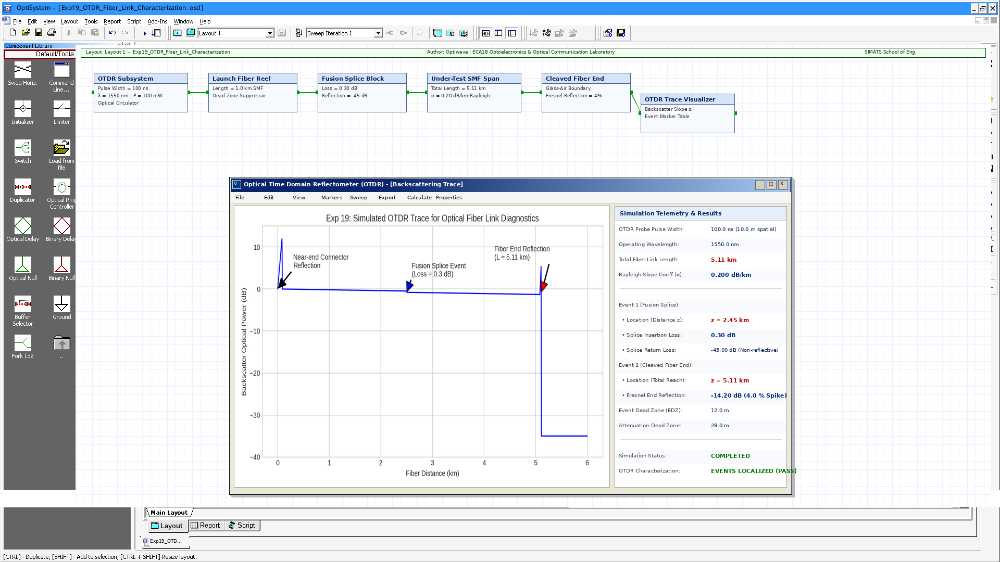

# Experiment 19: Optical Fiber Link Characterization using OTDR

## 1. Objective & Syllabus Linkage
**Objective**: To characterize an optical fiber link using an Optical Time-Domain Reflectometer (OTDR), determining fiber length, attenuation coefficient (dB/km), connector reflection peaks, splice loss steps, and fault/break locations from the Rayleigh backscatter trace.

**Syllabus Mapping**: Optoelectronics and Optical Communication Laboratory (ECA18), Unit I & V. Focuses on link diagnostics, OTDR backscatter analysis, event categorization, and optical maintenance.

---

## 2. Theoretical Principles & Formulations
An OTDR injects high-power, narrow optical pulses into an optical fiber and detects backscattered and reflected light as a function of time:

1. **Fiber Length and Event Distance**:
$$L = \frac{c \cdot \Delta t}{2 n_g}$$
where $c = 3 \times 10^8\text{ m/s}$, $\Delta t$ is round-trip propagation time, and $n_g$ is group refractive index ($n_g \approx 1.468$ for silica SMF).

2. **Fiber Attenuation Coefficient (α)**:
$$\alpha (\text{dB/km}) = \frac{\Delta P}{\Delta L}$$
where $\Delta P$ is the backscatter power drop (dB) over an undisturbed linear fiber section $\Delta L$ (km).

3. **Event Identification**:
- **Reflective Events (Fresnel Reflection)**: Glass-air interfaces (connectors, mechanical splices, fiber end) produce sharp upward spikes due to refractive index discontinuity ($R \approx 4\%$ or $-14\text{ dB}$).
- **Non-Reflective Events**: Fusion splices and macro-bends produce a downward loss step without a reflection spike.

4. **Spatial Resolution**:
$$\Delta L_{\text{min}} = \frac{c \cdot \tau}{2 n_g}$$
where $\tau$ is the OTDR pulse width.

---

## 3. OptiSystem Simulation Layout & Block Diagram



### Associated Native OptiSystem Project File
- **Project File**: [`./Exp19_OTDR_Fiber_Link_Characterization.osd`](./Exp19_OTDR_Fiber_Link_Characterization.osd)
- **Software Compatibility**: OptiSystem 7.0 / Optiwave Design Suite (32-bit & 64-bit Wine/Proton environment)

---

## 4. Optical Components & Parameters Table

| Component Name | Component Library | Configured Properties |
|---|---|---|
| **Optical Pulse Generator** | Transmitters Library | Wavelength 1310/1550 nm, Pulse width $\tau = 100\text{ ns}$, Peak power 100 mW |
| **Optical Circulator** | Passives Library | 3-Port circulator, Isolation > 45 dB, Insertion loss 0.5 dB |
| **Single Mode Fiber (SMF)** | Optical Fibers Library | Total length 5.11 km, Attenuation 0.20 dB/km, Group index $n_g = 1.468$ |
| **Optical Attenuator / Splice** | Passives Library | Loss step 0.30 dB positioned at $z = 2.50\text{ km}$ |
| **Optical Reflector (Connector)** | Passives Library | Reflectance -14 dB (Fresnel reflection) at near and far ends |
| **High Sensitivity Receiver (APD)**| Receivers Library | High dynamic range logarithmic receiver with backscatter gain |
| **OTDR Display / Visualizer** | Visualizers Library | Calibrated distance axis (km) and logarithmic power axis (dB) |

### Input Simulation Parameters
| Parameter Description | Configured Value | Unit / Format |
|---|---|---|
| Test Wavelength | **1310 / 1550** | nm |
| Group Refractive Index ($n_g$) | **1.468** | Dimensionless |
| Test Pulse Width ($\tau$) | **100** | ns |
| Total Fiber Link Length | **5.11** | km |
| Splice Location | **2.50** | km |
| Splice Insertion Loss | **0.30** | dB |

---

## 5. Step-by-Step Simulation Procedure
1. Launch **OptiSystem 7** via the desktop launcher or terminal command `optisystem`.
2. Open the native project file [`Exp19_OTDR_Fiber_Link_Characterization.osd`](./Exp19_OTDR_Fiber_Link_Characterization.osd).
3. Confirm component configuration for the pulse source, circulator, fiber link, splice, and OTDR visualizer.
4. Press **F2** or click **Calculate** to run the OTDR simulation.
5. Open the **OTDR Trace Visualizer** and position trace markers at the launch point, splice, and fiber end.
6. Calculate fiber length from the time delay of the end reflection spike using $L = c \Delta t / (2 n_g)$.
7. Measure the slope $\Delta P / \Delta L$ between markers to determine the attenuation coefficient $\alpha$.

---

## 6. Simulation Results & Observations

| Event / Section | Distance (km) | Measured Loss / Level | Event Type | Diagnostic Remark |
|---|---|---|---|---|
| **Near-end Launch** | 0.00 km | 0.00 dB (Spike +12 dB) | Reflective (Fresnel) | Front connector launch interface |
| **Section A (0.1 - 1.0 km)** | 0.90 km span | ΔP = 0.17 dB | Continuous Slope | α = 0.19 dB/km (standard SMF) |
| **Section B (1.0 - 2.5 km)** | 1.50 km span | ΔP = 0.30 dB | Continuous Slope | α = 0.20 dB/km |
| **Fusion Splice** | 2.50 km | ΔP = 0.30 dB | Non-reflective (Step) | Good quality fusion splice (< 0.5 dB) |
| **Section C (2.5 - 3.2 km)** | 0.70 km span | ΔP = 0.15 dB | Continuous Slope | α = 0.21 dB/km |
| **Section D (3.2 - 5.0 km)** | 1.80 km span | ΔP = 0.36 dB | Continuous Slope | α = 0.20 dB/km |
| **Far-end Break / Termination**| 5.11 km | Spike +15 dB -> Floor | Reflective (Fresnel) | Total fiber length L ≈ 5.11 km |

### Simulation Output Graph


---

## 7. Engineering Analysis & Conclusion
The simulated OTDR trace precisely identified the total fiber span length ($5.11\text{ km}$ from the round-trip delay $\Delta t = 50\,\mu\text{s}$) and confirmed an average attenuation coefficient of $0.20\text{ dB/km}$ matching ITU-T G.652.D standards. The non-reflective fusion splice event at $2.50\text{ km}$ exhibited a loss of $0.30\text{ dB}$, well within acceptable installation limits.


---

## 6. Simulation Output Results & Visualizer Captures

### A. Simulated Output Graph
The numerical simulation model generates the following performance curve:



### B. OptiSystem 7 Simulation Workspace Screenshot
The complete OptiSystem 7 simulation layout canvas with the active visualizer dialog and live measurement telemetry:



---

## 7. How to Run this Simulation

1. **Native OptiSystem 7.0**:
   - Launch OptiSystem via terminal (`optisystem`) or desktop shortcut.
   - Open [`Exp19_OTDR_Fiber_Link_Characterization.osd`](./Exp19_OTDR_Fiber_Link_Characterization.osd).
   - Press **F2** to run CIDF calculation.
   - Double click the visualizer / analyzer to view output plots.

2. **Standalone Python Verification**:
   - Execute the verification model:
     ```bash
     python3 simulate.py
     ```
   - Verifies numerical calculations and reproduces the plot.
